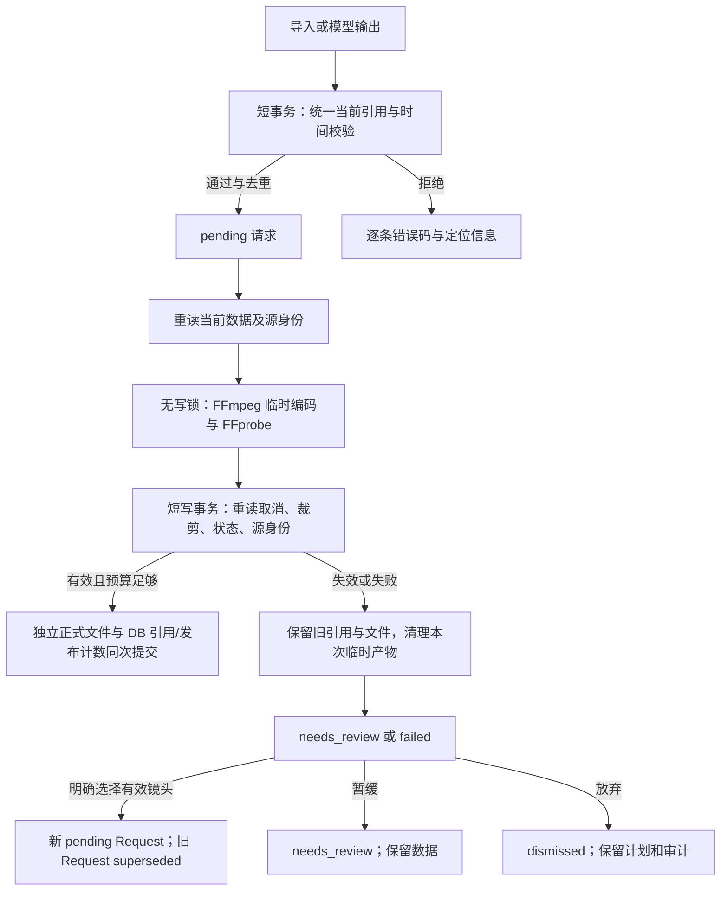

# Travel Storyboard v2.0.3 — 实现设计文档

> 本文档描述从需求方案到代码的实现设计，是 `backend/` 与 `frontend/` 的权威依据。
> 需求来源：《Travel_Storyboard_v2.0_详细设计方案.md》。

## 1. 目标与边界

**目标**：Windows 本地运行，把大规模旅行原片（60+ 视频 / 约 200GB）转化为可检索、可筛选、可复核、可导出的素材库，并支持分轮多模态分析生成旅行短片策划。

**非目标（首期）**：不实现专业调色 / 混音 / 完整 NLE；不宣称电影审美评分为客观真值；不承诺所有剪辑软件无损导入（尤其剪映需专项验证）。

## 2. 总体架构

```text
React 前端 (Vite + TS + Tailwind)
        |
  本地 REST API (127.0.0.1 + 访问令牌 + CORS 白名单)
        |
     FastAPI 应用层
        |-- 项目服务 ProjectService
        |-- 资源服务 MediaIndexer      (ffprobe, 稳定 asset_id, 文件变化)
        |-- 切镜服务 SegmentDetector   (场景边界, 长镜头子段)
        |-- 画质服务 QualityAnalyzer   (清晰度, 曝光, 重复)
        |-- 代理服务 FrameService      (代表帧, 低清预览)
        |-- 分析包服务 ReviewPackage   (M3: 上传包, 隐私, manifest)
        |-- 故事服务 StoryPlanner      (M3: AI 请求/结果导入导出)
        |-- 导出服务 TimelineExport    (M4: CSV/JSON/OTIO)
        |
   SQLite (WAL) + 本地缩略图/预览缓存 + JSON 导出
        |
   FFmpeg / FFprobe / OpenCV / 可选 AI（云端或本地）
```

**依赖原则**：核心扫描、抽帧、人工筛选完全离线可用；云端多模态 AI 为可选集成。

## 3. 技术选型

| 层 | 选型 | 说明 |
|---|---|---|
| 后端框架 | FastAPI + Uvicorn | 本地 REST，服务仅绑定环回地址 |
| ORM | SQLAlchemy 2.0 | 类型化、可替换数据库 |
| 数据库 | SQLite (WAL) | 默认；通过 `DATABASE_URL` 可切换 |
| 配置 | pydantic-settings | 读取 `.env` / 环境变量 |
| 媒体探测 | FFprobe | JSON 输出，解析视频/音频轨技术元数据 |
| 抽帧/代理 | FFmpeg | 列表参数调用（不依赖 shell 拼接） |
| 图像分析 | OpenCV + numpy + imagehash | 场景差异、清晰度、曝光、感知哈希 |
| 任务调度 | 内置 Job 表 + 线程池 | 并发 1–2，逐文件/逐段 checkpoint |
| 前端 | React 18 + TS + Vite + Tailwind | 分镜墙、拖拽、筛选 |

## 4. 目录结构

```
backend/
  app/
    main.py          # 入口：lifespan 初始化、静态托管、路由挂载
    config.py        # Settings（pydantic-settings）
    database.py      # engine / SessionLocal / Base / init_db（含幂等增量迁移）
    models.py        # ORM 模型
    schemas.py       # Pydantic schema
    security.py      # 令牌生成/校验、回环来源校验、鉴权中间件
    paths.py         # 数据根 / 项目工作区解析（含 output_dir）、重叠保护
    ffmpeg.py        # FFmpegLocator + probe + extract_frame + preview
    services/
      indexer.py       # M1 素材建库
      detector.py      # M2 场景/长镜头子段检测
      quality.py       # M2 画质指标 + 感知排重
      analyzer.py      # M2 检测编排：抽帧、增量跳过、缓存回收
      frames.py        # 代表帧选择与抽取
      review_package.py# M3 脱敏分析包（重编码、隐私、体积预算）
      story_planner.py # M3 复核请求导入 / 代理生成 / 直连模型分析
      timeline_export.py# M4 剪辑计划校验与 JSON/CSV/OTIO 导出
      roughcut.py      # M4 代理粗剪（含音频）
      runner.py        # Job 调度、互斥、取消、断点续跑
      model_client.py  # 可选视觉模型调用
    api/
      deps.py        # DB 会话依赖
      projects.py    # 项目 CRUD（输出目录校验）
      jobs.py        # 任务创建/状态/取消
      assets.py      # 素材列表/详情
      segments.py    # 片段列表/筛选/标注/in-out/重置裁剪
      media.py       # 白名单产物服务（帧/代理/包/粗剪）
      packages.py    # 分析包列表与下载
      story.py       # 复核请求与故事分析
      export.py      # 剪辑计划与导出
      system.py      # health / config
  tests/               # pytest：安全边界 / 数据一致性 / 任务 / 隐私 / 导出
frontend/
  src/
    main.tsx, App.tsx, router
    lib/api.ts       # 带令牌的 fetch 封装 + 媒体 URL 构造
    lib/types.ts     # 与 schemas.py 对应的类型
    lib/store.ts     # 应用引导与令牌状态
    lib/useJob.ts    # 任务轮询 hook
    lib/format.ts    # 时间码/体积格式化
    pages/           # Home / Project / Review / AIDirector / Export / Settings
    components/      # SegmentCard / FilterBar / JobProgress ...
scripts/               # start.ps1 / start.bat / start.sh 一键启动
docs/                  # DESIGN.md / REGRESSION.md
```

## 5. 数据模型

### 5.1 `projects`
- `id` (UUID 主键), `name`, `source_roots` (JSON: 素材根目录列表), `output_dir`
- `settings` (JSON: 片长/画幅/风格/采样预算等), `created_at`, `updated_at`

### 5.2 `assets`（原始视频）
- `id` (UUID, 稳定 asset_id), `project_id`
- `source_path` (绝对路径), `display_name`, `file_size_bytes`, `mtime_ns`, `quick_fingerprint`
- `duration_sec` (float, 小数秒), `fps_num`, `fps_den`, `vfr_flag`
- `width`, `height`, `rotation`, `codec`, `pixel_format`
- `color_primaries`, `color_transfer`, `color_space`
- `has_audio`, `audio_codec`
- `scan_status` (pending/running/succeeded/failed/skipped), `error_code`, `error_message`
- `analysis_version`, `scanned_at`
- `analyzed_fingerprint`, `analyzed_detect_config`, `analyzed_at`（增量检测用）

**唯一约束**：`(project_id, source_path)` 唯一，保证同项目同文件只有一行；
探测失败时复用同一行并置 `scan_status=failed` / `error_code=probe_failed`，不会插入第二行。

**增量判断**：每次重新采样头/中/尾内容，规范化路径、大小、mtime_ns 和快速指纹均相同才跳过重扫。
检测阶段比较 `analyzed_fingerprint == 本次 scan_signature` 和任务快照中的检测配置指纹；
`force=true` 可强制重算，`options.full_hash=true` 可加入全文件 SHA-256。

### 5.3 `segments`（候选片段）
- `id` (UUID, 稳定 segment_id), `asset_id`, `project_id`
- `detected_start_sec`, `detected_end_sec` (**检测产生的不可变边界**), `is_trimmed`
- `start_sec`, `end_sec` (可编辑的有效区间，源文件时间线，小数秒)
- `boundary_reason` (hard_cut / content_change / max_duration / manual)
- `quality_metrics` (JSON: 曝光/模糊/重复/稳定性 + 置信度)
- `content_tags` (JSON: 标签 + 来源 rule/ai/manual)
- `story_role`, `user_rating`, `status`
- `frame_refs` (JSON: 代表帧路径列表), `proxy_ref`
- `parent_segment_id`, `algorithm_version`

> **为什么边界要分两份**：重新检测时按 `detected_*` 匹配既有片段，因此人工裁剪、
> 评分、备注在重复检测后仍然保留。早期版本用 `start_sec/end_sec` 匹配，
> 一旦裁剪过就会被判定为新片段，标注随之丢失。

### 5.4 `frames`（代表帧）
- `id`, `segment_id`, `asset_id`, `time_sec` (小数秒)
- `image_path` (工作区相对路径；自定义输出目录时为绝对路径), `phash` (感知哈希), `is_representative`
- `width`, `height`, `file_size_bytes`

### 5.5 `jobs`（任务 / 断点）
- `id`, `project_id`, `job_type` (scan / detect / package / proxies / roughcut)
- `status` (pending/running/succeeded/partial_failed/failed/cancelled)
- `config_snapshot` (JSON), `stats` (JSON: 总数/成功/失败/进度), `resume_token` (JSON)
- `failures` (JSON: `{count, items:[{kind, ref, message}]}`，部分失败的逐项原因)
- `error`, `created_at`, `started_at`, `finished_at`

### 5.6 `user_annotations`（人工标注，独立保存，重跑不丢失）
- `id`, `segment_id`, `rating` (like/favorite/exclude/pending), `note`
- `in_sec`, `out_sec` (人工调整后的区间), `created_at`, `updated_at`

> M3/M4 新增表：`review_packages`、`review_requests`、`edit_plan_shots`，
> 由 `create_all` 建表；旧库的增量列由 `init_db()` 的迁移列表补齐（迁移前自动备份）。

## 6. 关键算法

### 6.1 素材建库（M1）
1. 递归遍历 `source_roots`，按扩展名过滤视频文件。
2. 规范化路径、大小、mtime_ns 与重新采样的头/中/尾快速指纹均命中既有 asset → 跳过。
3. `ffprobe` 解析技术元数据；新文件生成 UUID `asset_id`。
4. 单文件失败 → 标记 `failed` + `error_code`，不阻塞全局。
5. 每文件落库并推进 `resume_token`，支持中断续跑。

### 6.2 场景边界 + 长镜头子段（M2）
1. 以低分辨率（如 1 fps 或更稀疏）采样帧，计算相邻帧 HSV 直方图差异。
2. 差异超过阈值 → 硬切候选；自适应阈值缓解快速运动误切。
3. 连续无切点超过 `max_segment_duration`（默认 30s，可配置）→ 在内容变化峰值处强制切分。
4. 记录 `boundary_reason` 与 `algorithm_version`。

### 6.3 代表帧选择（M2）
1. 每个候选片段取 1–3 张：起点避黑帧、中间代表帧、内容变化帧。
2. 片段极短时不机械重复取图。
3. 记录每视频覆盖率与未检查区间。

### 6.4 画质指标（M2）
- 清晰度：Laplacian 方差。
- 曝光：亮度均值 + 过曝/欠曝比例。
- 重复：感知哈希（dHash）Hamming 距离 + 时间相邻信息。
- 低技术质量不自动舍弃，保留“有故事但画质一般”的候选。

## 7. 安全与隐私

- 服务仅绑定 `127.0.0.1`；首次启动生成随机访问令牌（写入 `data/token.txt`，权限 `0600`）。
- **不提供任何免鉴权的令牌下发接口**（早期的 `/api/system/token` 已删除）。令牌由启动日志给出，
  前端通过 `/?token=…` 读取一次后存入 `sessionStorage` 并从地址栏移除。
- 所有 `/api/*` 需携带 `X-Access-Token`（或 `?token=`）。仅 `/api/system/health` 与
  `/api/system/config` 免令牌，且两者只返回可用性与工具**名称**，不含任何本机绝对路径。
- 请求的 `Host` / `Origin` / `Referer` 必须是回环地址，否则 403（防 DNS rebinding）。
- 媒体服务不接受任意路径：只服务「已解析后确实位于该项目工作区、且位于白名单子目录
  （`frames`/`proxies`/`packages`/`roughcut`/`contact_sheets`）、扩展名在白名单内」的文件。
  数据库与 `token.txt` 位于数据根目录，不在任何项目工作区内，因此无法被这些路由触达。
- 原片只读打开；产物写入隔离工作区。项目工作区不得与素材目录重叠（含父子关系），
  否则创建/修改项目返回 422。
- 分析包的隐私承诺是**被强制执行**的：分镜图一律用 Pillow 解码后重编码（EXIF/GPS/相机信息
  无法存活）、只收录被选中片段引用到的素材、manifest 不写 ffmpeg 绝对路径、受体积预算约束。
  这不等于人脸/车牌已脱敏 —— 仍需用户自行查看后再上传。

## 7.1 Windows 长路径（`MAX_PATH`）适配

Windows 在未启用 `LongPathsEnabled` 时限制路径为 260 字符。危险之处不是「报错」，
而是**FFmpeg 能写、Python 看不见**：FFmpeg 是原生程序，会走扩展长度 API 写出文件，
而 Python 的 `os.path` 随后 `FileNotFoundError`，表现为「FFmpeg 返回 0 却没产出」。

关键认识：**没有单一修复点**。以下各自是独立的兼容边界，必须分别处理：

| 边界 | 处理方式 | 原因 |
| --- | --- | --- |
| FFmpeg / FFprobe 命令行 | `long_path()` → `\\?\`（UNC 为 `\\?\UNC\`） | 原生程序认这个前缀 |
| Python `Path` 操作 | `safe_stat` / `safe_is_file` / `safe_mkdir` / `safe_unlink` / `safe_replace` / `safe_write_text` | `Path.mkdir(parents=True)` 自己逐层走路径，超限即失败 |
| 文件读写 | `safe_open` | `open` 受同一限制 |
| Pillow | `safe_image_open` | 其内部 `builtins.open` 受限制，改为自行读字节后交给 Pillow |
| OpenCV | `cv2.imdecode` + 自行读字节 | `cv2.imread` 走 C 文件 API，长路径/非 ASCII 下**返回 `None` 而不抛异常** |
| ffconcat 清单 | 单引号条目 + POSIX 分隔符，**不用** `\\?\` | 见下 |

`ffconcat` 是最容易踩坑的一处，均为本机 FFmpeg 实测结论：

- `file "path"` —— 双引号**不被**解析为引号，FFmpeg 会去找名为 `"C:/...` 的文件；
- `file path` —— 在第一个空格处截断；
- `file 'path'` —— **唯一可用**形式；
- 路径中的 `\` 被当作转义符，原生 Windows 路径会被静默破坏（`C:\Users` → `C:Users`），
  因此统一输出 `/`；
- 清单**内部**不能使用 `\\?\` 前缀（那是命令行专属），且不写 BOM。

两条实现原则：

1. **只在路径不存在时回退**。`safe_*` 系列捕获 `FileNotFoundError` 而非 `OSError`，
   否则 `PermissionError`（文件被占用）会被误判为长路径问题，错误分类随之失真。
2. **在边界校验产物**。`run()` 支持 `expect_output` / `expect_pattern`，
   并区分「路径过长」与「根本没写」，抛出 `PATH_TOO_LONG` / `OUTPUT_NOT_CREATED`。
   单图输出还需 `-update 1`，否则 `image2` muxer 对无 `%03d` 的文件名会拒绝写入却以 0 退出。

`detector` 另有一处静默成功：抽样帧**全部**无法解码时，旧实现会返回单个 `single`
镜头。现在抛 `MEDIA_UNREADABLE`，部分失败则记 warning。

## 8. 断点续跑与并发

- `runner.py` 维护进程内线程池（`ThreadPoolExecutor(max_workers=max_concurrency)`），
  线程池关闭后可重建，便于测试与多次 lifespan。
- Job 状态机：`pending → running → succeeded / partial_failed / failed / cancelled`。
  - `partial_failed`：任务本身跑完，但有逐项失败（`failures` 记录 kind/ref/message）。
  - `cancelled`：通过 `POST /api/jobs/{id}/cancel` 触发，任务内的 `raise_if_cancelled()` 生效。
- 同一项目内 `scan`/`detect`/`package`/`proxies`/`roughcut` 互斥，重复提交返回 409。
  - 创建逻辑统一在 `services/job_service.create_project_job()`，`/jobs/{job_type}` 与
    `/review-requests/proxies` 共用，不存在绕过互斥的第二条路径。
  - 「检查是否已有活跃任务」与「INSERT」在同一个 `BEGIN IMMEDIATE` 事务内完成。
    仅靠进程内 `RLock` 或前端禁用按钮都不够：两个请求可在检查与提交之间交错。
  - 冲突返回 409，`detail` 含 `error_code=JOB_CONFLICT`、`active_job_type`、
    `active_job_id`；被拒绝的请求不留下 Job 行。
- 每个文件/片段完成后更新 `stats` 与 `resume_token`；进程重启时 `resume_interrupted_jobs()`
  会把遗留的 `pending`/`running` 任务重新派发。
- 抽帧先写独立 `staging/<asset>/<run_id>/`，验证后发布新版本、提交 DB，再回收旧版无引用 JPEG；检测按素材签名 +
  算法/配置指纹跳过未变化的素材。

## 9. API 一览

实际路由由 `app.openapi()` 生成，共 33 个操作。下表为人工归纳。

| 方法 | 路径 | 说明 |
|---|---|---|
| GET | `/api/system/health` | 健康检查（免令牌；只返回工具名，不含路径） |
| GET | `/api/system/config` | 公开配置（免令牌；数据目录只给目录名） |
| GET/POST | `/api/projects` | 列出 / 新建项目（含 `cache_dir`） |
| GET/PATCH/DELETE | `/api/projects/{id}` | 项目详情 / 更新 / 删除（校验输出目录重叠） |
| GET | `/api/projects/{id}/assets` | 素材列表（分页/筛选） |
| GET | `/api/assets/{id}` | 素材详情 |
| POST | `/api/projects/{id}/jobs/{job_type}` | 启动任务（`scan`/`detect`/`package`/`proxies`/`roughcut`） |
| GET | `/api/projects/{id}/jobs` | 项目任务列表 |
| GET | `/api/jobs/{id}` | 任务状态（含 `stats`、`failures`、`resume_token`） |
| POST | `/api/jobs/{id}/cancel` | 取消任务 |
| GET | `/api/projects/{id}/segments` | 片段列表（筛选/分页；含检测边界与裁剪标记） |
| GET/PATCH | `/api/segments/{id}` | 片段详情 / 更新 |
| POST | `/api/segments/{id}/annotate` | 人工标注（收藏/排除/备注/in-out，校验裁剪范围） |
| POST | `/api/segments/{id}/reset-trim` | 清除裁剪，回到检测边界 |
| GET | `/api/frames/{id}/image` | 代表帧图片（按数据库记录授权） |
| GET | `/api/projects/{id}/media` | 项目工作区内的白名单产物 |
| GET | `/api/projects/{id}/review-requests/{rid}/proxy` | 第二轮低清预览 |
| GET | `/api/projects/{id}/roughcut` | 代理粗剪（缺镜头时为 `roughcut_INCOMPLETE.mp4`） |
| GET | `/api/projects/{id}/packages` | 列出分析包 |
| GET | `/api/packages/{id}/download` | 下载分析包 zip |
| POST | `/api/projects/{id}/review-requests/import` | 导入 `review_requests.json`（严格校验） |
| GET | `/api/projects/{id}/review-requests` | 列出复核请求 |
| POST | `/api/projects/{id}/review-requests/proxies` | 生成第二轮低清预览 |
| POST | `/api/projects/{id}/story/analyze` | 可选直连模型分析（含覆盖统计与结构化校验） |
| GET/POST | `/api/projects/{id}/edit-plan` | 读取 / 保存剪辑计划（全量校验） |
| GET | `/api/projects/{id}/export/{json,csv,otio}` | 导出时间线 |

## 10. 里程碑与验收对照

| 里程碑 | 内容 | 状态 |
|---|---|---|
| M1 | 素材建库：ffprobe 索引、稳定 `asset_id`、SQLite、增量 + 断点续跑 | ✅ |
| M2 | 镜头识别 + 画质：场景边界、长镜头子段、代表帧、感知排重、画质指标 | ✅ |
| M3 | 双轮 AI 闭环：脱敏分析包 + 复核请求导入 + 低清预览 + 可选直连模型 | ✅ |
| M4 | 故事板 + 导出：剪辑时间线 CSV / JSON / OTIO、代理粗剪 | ✅ |

具体验收场景见 [REGRESSION.md](REGRESSION.md) 的 T01–T19 清单（自动化部分由
`backend/tests/` 覆盖，生成素材真实解码在独立 Ubuntu/Windows FFmpeg Job 必跑，旅行实片仍需手工）。

> OTIO 已用参考实现 `opentimelineio` 做读回校验（结构、clip 数、源区间、
> 总时长一致），但**尚未在真实 NLE 中实测**；直连模型路径在未配置
> `TRAVELSB_MODEL_BASE_URL` / `TRAVELSB_MODEL_API_KEY` 时走离线分析包流程。

## 11. 已知依赖与后续

- FFmpeg 路径可配置，支持 PATH / 环境变量 / 常见安装目录探测；
  `scripts/start.ps1` 会在启动前提示是否就绪。
- **数据库迁移**：`init_db()` 执行幂等的增量迁移（补列），迁移前通过 SQLite Backup API（包含 WAL）生成快照
  保存为 `<name>.pre-migration-<时间戳>.bak`。目前未引入 Alembic；
  当出现需要重建表或改写数据的变更时应切换到 Alembic。
- 已知限制：早于检测边界拆分版本、且没有 detected_* 列的旧镜头已被裁剪时，其原始边界无法还原，首次补列回填等于裁剪区间，
  再做检测会被视为新镜头（升级后新产生的裁剪不受影响）。
- 检测算法为 1 fps HSV 直方图硬切，快速移动可能误切、短转场可能漏切；
  尚未在真实旅行片上做混淆矩阵与阈值校准。


## v2.0.1 稳定性协议（TSB-201～208）

- **状态机**：pending → running → succeeded / partial_failed / failed / cancelled。
  每个状态写入使用带预期活动状态的 SQL UPDATE；终态不可互相覆盖。取消为协作式，
  当前 FFmpeg 调用可能继续，但后续素材、片段和发布前检查取消。任务已取消但线程尚未
  退出时继续占项目锁；创建新任务或移动工作区返回 409。恢复按 created_at 排队，同项目
  缓存任务逐个派发；失败列表从数据库恢复、按对象去重，成功重试移除相应失败记录。
- **工作区**：比较规范化后的项目根路径。只要有分析状态、计划、复核请求、历史包、
  媒体文件或活动任务，output_dir 变更整批拒绝（WORKSPACE_HAS_DATA）；名称/设置更新
  不受目录保护阻挡。本版不自动迁移。媒体路由仍执行项目边界与目录/扩展名白名单。
- **指纹/续跑**：scan_signature 为规范化路径、大小、mtime_ns、头/中/尾各 64 KiB
  内容的 JSON 摘要；取样偏移也纳入快速内容指纹。full_hash=true 追加全文件 SHA-256，
  代价为读取全部源文件。快速指纹不是全内容等价证明。detect_signature 还含算法版本、
  sample_fps、threshold、max_segment_sec、thumb_width。任务创建时清单和参数写入
  config_snapshot；resume_token.items 保存每个路径/asset_id 的签名及
  pending/completed/failed/skipped 状态。恢复合并新增项，失效变化/移除项并报告警告；
  不再使用 last_index / last_asset_id 作为跳过依据。旧任务保守重新检查一次。
- **缓存发布**：每次分析有 run_id；staging 和最终 JPEG 文件名包含该版本，不覆盖旧图。
  所有图片可完整解码后发布，再提交 Frame/Segment 引用；DB 失败回滚并回收本次发布。
  成功提交后清理上一版无引用帧。分析前/后可重试 cleanup_orphan_frames，默认 1 小时
  宽限期，只清理项目 frames/staging 内数据库没有引用的 JPEG，不跟随符号链接。
  文件系统和 DB 不是原子事务：强制退出可能留下孤儿文件，宽限期后下一次分析回收。
- **AI 抽样**：favorite > like > pending > 其他，exclude 排除。组内按评分、源时间、ID
  排序；首轮每素材至多一段，按首段评分和 asset_id 排序，再补第二轮。候选限额在公平
  排序之后应用。图片按距离有效片段中点最近选择，缺图不计覆盖。complete 只有全部
  候选镜头和库内素材均被实际图片覆盖时为真；库内只含 exclude 镜头的素材仍算未覆盖。
- **计划/粗剪**：完整恢复编辑字段；dirty 草稿拒绝查询刷新覆盖，显式重新加载可放弃草稿。
  保存按数组顺序重排，任何非法项整批拒绝。source_in/out 均约束在当前片段内（1 ms
  容差），时长/置信度必须有限。JSON/CSV/OTIO/粗剪均读同一排序后的保存计划。
  粗剪使用独立 staging MP4，成功且未取消后 replace 最终文件；完整/不完整文件及
  X-Roughcut-Incomplete 标头区分结果。低帧率源的尾帧延续到精确计划时长，音轨补齐。
- **兼容性**：无新增 ORM 列/表；签名/清单/版本用现有字段和 JSON 存储。旧 JPEG 引用及
  Segment ID 可继续使用；边界稳定时人工评分、裁剪及引用保持。已有历史数据库迁移
  改用 SQLite Backup API（包含 WAL），只为新加入的检测边界列做回填，保留合法零值。
  停止应用后可整体恢复迁移备份，避免主库和 WAL 不配套。
- **CI**：原后端矩阵保留；独立 Ubuntu/Windows Python 3.11 媒体任务强制安装并打印
  FFmpeg/FFprobe 版本，TSB_REQUIRE_FFMPEG=1 下缺依赖、合成失败或任何 skip 均失败。
  前端 CI 增加实际组件测试。媒体测试报告作为 Actions artifact 保存。

## v2.0.2 字段所有权、后台签名与引用事务

本节更新上一版协议：创建任务时只持久化配置，不在 HTTP 线程构建素材清单或计算签名。
后台枚举并保存首份快照，`resume_token.items` 保存逐项可恢复状态；quick / full 模式明确
记录。完整校验使用 1 MiB 流式块，一次作业默认每文件一遍；处理后使用轻量身份/指纹检查，
只有显式 strict_full_hash 才在发布前再全读一次，累计 bytes_read 和 strict_extra_bytes
均持久化。新完整校验任务重新读取，不跨任务凭时间戳直接复用哈希；同任务恢复依快速
签名及 size/mtime/ctime/dev/inode 检查复用完整结果。半途的单文件哈希重启后从头读取，
累计 I/O 不清零。所有 hash/manifest I/O 都在后台，块间取消、阶段起止/进度均可查询。

算法计算只生成独立结果，不把抽帧前的旧 ORM 对象 merge 回数据库。短写事务先执行
BEGIN IMMEDIATE，重新读取当前 Segment，只更新 detected_*、boundary_reason、
algorithm_version、quality_metrics、frame_refs。人工 rating、story_role、content_tags、
status、proxy_ref 和独立 UserAnnotation 原样保留；最新合法人工 trim 原样保留。只有
检测边界轻微移动时夹取最新 trim，原选择记入 quality_metrics.manual_trim_audit，标记
needs_review；若不能相交，保留原选择/is_trimmed 而不是静默清空。未裁剪的有效边界随
最新检测结果更新。备注 PATCH/POST 统一持久化，并由详情/列表返回供页面恢复。

无法匹配的旧镜头在同一写事务检查计划/复核/注释及人工状态。受保护行标为 needs_review，
保留旧 Frame 和 JPEG；未复核行不作为新分析包/AI 样本/计划/粗剪来源。保存计划、导入
复核请求和模型请求持久化也在 BEGIN IMMEDIATE 下验证和写引用，避免验证/插入之间
产生悬空 ID。模型返回后复查当前 ID、资产、项目、状态、范围，不相信过去的抽样快照。
不对受保护旧镜头做自动 ID 映射。新图片发布、事务切换、旧无引用图回收的崩溃协议保持。

没有新增表/列或批量重建历史数据；审计/警告使用现有 JSON 和 status。旧版本 Job 缺少
签名上下文时保守再验证一次；检测版本更新为 2.0.2，已有分析首次普通检测会按新协议
重算，但稳定边界 ID/人工字段/引用保持。SQLite writer timeout 30 秒，只用于短提交，
长检测/抽帧/完整哈希不持有写锁。VFR 的真实旅行源仍需专项验收；CFR 尾段代表时间
不超过最后可解码帧时间，修复 1 fps 长片尾帧后的无帧请求。


Windows 平台兼容：用 birthtime_ns 统一 Windows path-stat/handle-fstat 的创建身份，避免
Python 3.13 等版本的 ctime 语义差异；POSIX 仍保留 metadata-change ctime。大小、mtime、
设备、inode、创建身份校验都保持，完整 SHA-256 不跳过。恢复测试使用显式 created_at，
生产恢复仍按 created_at + ID 确定性排序，不假设 Windows 时钟提供唯一微秒时间戳。

## v2.0.3 复核引用与发布协议（TSB-231～235）

`services/review_validation.py` 是复核请求的统一准入契约：校验项目、Asset、Segment 的关联，拒绝 `needs_review/archived/invalid`，拒绝非有限数、负入点、反向或不足 0.2 秒的区间。请求必须包含于最新有效裁剪和素材时长；时间容差统一为 0.001 秒。导入按条返回失败和重复定位信息；直连模型只允许在内存里修正至多 0.05 秒的边界误差，并明确报告，落库再次严格校验。

分析包在 SQL 查询时先排除评分和失效状态；同一批有效 ID 决定 JSON、代表帧和联系表。只包含最新有效区间内且能解码的代表帧，缺帧镜头连同不再使用的 Asset 一起排除。空选择报可操作错误。图片继续重编码去 EXIF；Manifest 统计采用依次排除口径：评分 → 失效状态 → 源文件/范围 → 缺帧/预算 → 实际入包。每次未提交的打包尝试使用独立目录，避免恢复时把旧快照文件带入 ZIP；已提交结果通过 Job.resume_token 复用。最终短写事务再次检查选择和源文件，变化时删除本次新包，保留历史包。

代理任务只长期保留请求 ID；每条执行前重读请求、镜头和素材。FFmpeg 按精确 `end-start` 写入 `proxies/staging/<job-id>-<attempt>/`，SQLite 不持有写锁。FFprobe 验证输出可读后，再申请有 30 秒超时的短 `BEGIN IMMEDIATE`：重查取消、状态、裁剪、请求修订和源身份；成功才重命名为独立正式文件、提交请求引用及本作业发布清单/实际字节数。数据库失败回滚时仅删除本次文件。预算不足保留 `pending`，报告 `BUDGET_EXCEEDED`/`partial_failed`；恢复相同作业不会重置已提交预算。临时代理不能通过 media API 读取。

`Asset.analyzed_source_signature` 保存检测时的轻量签名，独立于 quick/full 模式的 `analyzed_fingerprint`，从而能检查重新扫描后的素材是否仍与旧检测一致。新增列通过原 WAL 备份机制做幂等迁移；旧完整检测可从匹配精确分析摘要的 Job 检查点恢复轻量签名。旧快速检测可直接验证原签名；未知历史完整签名要求重新检测，不能猜测当前源仍对应旧结果。`ANALYSIS_VERSION` 保持 2.0.2，已有有效缓存不因应用升级强制重算。

人工处置 API 在短事务中处理：显式选当前镜头和区间产生新 Request，新旧 Request 通过 `supersedes_request_id/superseded_by_request_id` 互相追溯；旧请求转为 `superseded`，旧 Segment ID、人工备注、收藏、用途、计划引用和历史预览不变。暂缓保留 `needs_review`，放弃为 `dismissed`，均不会清除人工镜头信息。重试只在当前引用和源验证通过后回到 pending。前端使用后端给出的有效候选和错误信息，不自动映射 ID。旧计划存在引用时链接到导出页，由用户人工更新。



完整哈希是每个任务的成本：200GB 分别完整扫描和检测可能多读约 400GB；严格复核会再读，未完成文件重读另计，FFmpeg 解码 I/O 也另计。界面显示 hashing/processing/hash_recheck、取消、源变化、人工复核、字节进度和重读次数，不给固定 ETA。实际发布证据和未执行的 Windows 实机验收见 `RELEASE_V2_0_3.md`。
