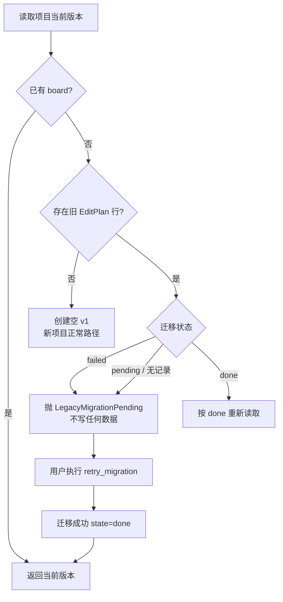

# TSB-366-R1 — 版本化底座质量收口与数据一致性修复

| 字段 | 内容 |
|---|---|
| 任务编号 | TSB-366-R1（P0 质量收口） |
| 基线 | `main@8f2d4ebbb74840304b668746030515d5379f15b4`（TSB-366 交付提交，工作区干净） |
| 产品版本 | `2.1.2`（未升版） |
| 证据目录 | [docs/validation/tsb366-r1/](validation/tsb366-r1/) |
| **最终 SHA** | **`f9c552ecffd28f598222b984d53308503961ba01`** |
| CI | run #95 7/7 success |
| 范围 | 只修 5 个已知缺陷 + 1 项边界审查；**不重新设计、不开发 TSB-367** |

> **结论：5 个 P0/P1 缺陷全部修复，写入校验边界给出明确结论并以测试固定；
> 新增 24 项后端专项 + 8 项前端专项，全部通过。**
> 后端全量 1455 项仅剩 1 项 `test_vision_provider` 408 失败，已双向取证为**基线既有**，
> 不计入本轮新增缺陷。

---

## 一、开工前核对（任务书「开始前先检查」）

| 检查项 | 结果 |
|---|---|
| `git status --short` | 干净（0 项） |
| `git branch --show-current` | `main` |
| `git rev-parse HEAD` | `8f2d4ebb…` ✅ 与任务书要求一致 |
| `origin/main` | 同上，无差异 |
| 项目管理文件 | `AGENTS.md`、`README.md`、`VERSION`(2.1.2)、`docs/RELEASE_TSB_366.md` |
| 原始任务书一致性 | 逐项实测确认，见下表 |

### 任务书描述 vs 实际代码（逐项实测，全部属实）

| 编号 | 任务书描述 | 实测结论 |
|---|---|---|
| P0-01 | `GET /edit-plan` 取目标版本但 `export_json(project_id)` 不传版本 | **属实**：`api/export.py` 先 `_resolve_version` 后 `export_json(project_id)`，只改响应里的 `version_id` |
| P0-02 | `DraftShot` 无 `shot_id`，`loadServer` 丢弃 | **属实**：接口无该字段，`loadServer` 逐个字段重建对象 |
| P1-03 | 恢复成功直接 `dirty=false`，无确认 | **属实**：`onSuccess` 内 `setEditor({...current, dirty: false})` |
| P1-04 | 迁移失败继续启动 + 无 board 时造空版本 | **属实**：`main.py` 吞异常；`get_current_version` 无条件建空 v1 |
| P1-05 | `reconcile_project` 用 `current_version_id` | **属实**：直接取 `board.current_version_id` |

**不一致项**：未发现任务书与实际代码的矛盾。任务书未提及的一处补充：
`EditPlanShotIn`（HTTP 请求 schema）同样缺 `shot_id` 字段，属于 P0-02 的同一根因，一并修复。

---

## 二、缺陷、修复与测试证据

### P0-01 历史版本读取内容错配

**问题**：请求 v1 时，响应头/字段写 `v1`，`shots` 却来自当前版本 v2 —— 元数据与内容不一致。

**修复**（`backend/app/api/export.py`）：解析出的 `version_id` 一路传到渲染层。

```python
# 改前
view = _resolve_version(project_id, version_id)
data = export_json(project_id)          # ← 总是当前版本
data["version_id"] = view.version_id    # ← 只改标签

# 改后
view = _resolve_version(project_id, version_id)
data = export_json(project_id, version_id=view.version_id)   # 同一版本贯穿
```

四个入口（`GET /edit-plan`、`/export/json`、`/export/csv`、`/export/otio`）全部验证传参。

**新增测试**（`test_tsb366r1_regressions.py`）：

| 用例 | 验收点 |
|---|---|
| `test_p0_01_get_edit_plan_returns_the_requested_historical_version` | v1(3 镜头) vs v2(8 镜头)，请求 v1 必须得 3 个，且 `total_duration_sec` 为 v1 的 6.0 |
| `test_p0_01_json_export_of_a_historical_version_is_self_consistent` | JSON 镜头数、`segment_id`、`source_in_sec` 全属 v1 |
| `test_p0_01_csv_export_of_a_historical_version_is_self_consistent` | CSV 行数 3 |
| `test_p0_01_otio_export_of_a_historical_version_is_self_consistent` | OTIO clip 数 3 |
| `test_p0_01_reading_a_historical_version_does_not_move_the_pointer` | 读四种入口后 `current_version_id` 仍为 v2 |
| `test_p0_01_the_default_read_still_returns_the_current_version` | **兼容行为不变**：不带 version_id 仍返回当前 v2 |

**RED 原文**：
```
assert len(data["shots"]) == 3
asked for v1 (3 shots) but got 8 shots — metadata and content disagree
```

---

### P0-02 shot_id 在前端编辑保存时丢失

**问题**：只改一个时长，三个镜头的身份全部变化（每次保存重新生成 UUID）。

**修复**：

| 文件 | 改动 |
|---|---|
| `frontend/src/pages/Export.tsx` | `DraftShot` 增加 `shot_id?`；`loadServer` 原样保留 |
| `frontend/src/lib/types.ts` | `EditPlanShotOut` 增加 `shot_id?` / `section_id?` |
| `backend/app/schemas.py` | `EditPlanShotIn` 增加 `shot_id`（HTTP 客户端的身份回传通道） |

后端 `_shots_from_input` 的兼容行为保留：缺失 `shot_id` 时才生成新 UUID（新镜头），
**正常编辑不依赖它**。

**新增测试**：

| 用例 | 验收点 |
|---|---|
| `test_p0_02_an_edit_round_trip_preserves_every_shot_id` | 改第 2 个镜头时长 → 3 个 id 全不变 |
| `test_p0_02_adding_a_shot_only_creates_one_new_identity` | 新增 1 个 → 只多 1 个新 id |
| `test_p0_02_removing_a_shot_leaves_the_others_untouched` | 删中间 → 其余 id 不变 |
| `test_p0_02_reordering_keeps_identity_tied_to_the_shot_content` | 全反序 → `shot_id→segment_id` 映射不变，时间线按数组顺序重排 |
| `test_p0_02_the_legacy_endpoint_preserves_shot_ids_too` | HTTP 路径同样保留 |
| 前端 `P0-02 keeps every shot_id through load, edit and save` | 保存 payload 中 10 个 `shot_id` 完整 |
| 前端 `P0-02 an added shot receives a new id while the others keep theirs` | 新增镜头**不带** `shot_id`，由服务端分配 |

---

### P1-03 恢复历史版本时保护未保存草稿

**问题**：`dirty=true` 时点击恢复，草稿被静默清除，且无任何确认。

**修复**（`frontend/src/pages/Export.tsx`）：

1. 新增 `requestRestore()` 门禁：`dirty=false` 直接恢复；`dirty=true` 弹确认，
   **取消则不发请求**；
2. 恢复成功后设置 `forceReload` 一次性标志，由既有同步 effect 用**服务端返回的新版本**
   重建编辑器，`dirty` 只在该同步中清除；
3. 恢复失败时只显示提示，`draft`/`baseVersionId`/`dirty` **一律不动**；
4. 同时刷新 `edit-plan`、`storyboard`、`storyboard-versions` 三个查询缓存。

**新增测试**（前端）：

| 用例 | 验收点 |
|---|---|
| `P1-03 restoring a clean editor needs no confirmation` | `dirty=false` 不弹确认 |
| `P1-03 cancelling the confirmation sends no restore request and keeps the draft` | 取消 → **0 次** restore 调用，草稿值不变 |
| `P1-03 confirming sends the restore request` | 确认 → 恰好 1 次 restore 调用 |

---

### P1-04 迁移失败后禁止初始化空方案

**问题**：迁移失败 → 用户打开方案 → 自动创建空 v1 → 迁移检测到 board 后**永久跳过**，
旧计划从此不可见。

**修复**：

| 文件 | 改动 |
|---|---|
| `backend/app/models.py` | 新增 `LegacyPlanMigration` 表（`UNIQUE(project_id)`，`state`/`error`/`attempts`/`legacy_shot_count`） |
| `backend/app/services/storyboard_migration.py` | 每次尝试**都**写状态（含失败）；新增 `migration_status()` 与 `retry_migration()` |
| `backend/app/services/storyboard_service.py` | 新增 `LegacyMigrationPending`；`get_current_version` 在建空版本前先检查旧计划与迁移状态 |

**判定规则**（写进代码注释与测试）：

| 情形 | 行为 |
|---|---|
| 无旧计划、无 board | ✅ 允许创建空 v1（新项目正常路径） |
| 有旧计划、迁移成功 | ✅ 读 v1 |
| 有旧计划、迁移失败 | ❌ 抛 `LegacyMigrationPending`，**不写任何数据** |
| 有旧计划、尚无迁移记录 | ❌ 同样拒绝 |

失败记录写在**独立事务**中（失败项目的事务已回滚，无法承载该行）。

**新增测试**：

| 用例 | 验收点 |
|---|---|
| `test_p1_04_a_project_with_no_legacy_plan_may_initialize_an_empty_board` | 新项目正常初始化 |
| `test_p1_04_a_migrated_legacy_project_reads_its_v1` | 迁移成功后读 v1 |
| `test_p1_04_a_failed_migration_must_not_yield_an_empty_initial_version` | 失败后读取**抛错**，且 `storyboards` 计数仍为 0 |
| `test_p1_04_a_failed_migration_records_a_queryable_error_then_retries` | 失败可查（`state=failed` + `error`），重试后成功且 `state=done` |
| `test_p1_04_a_retry_is_idempotent_and_leaves_migrated_projects_alone` | 重试 skipped，版本数不变 |
| `test_p1_04_retry_does_not_disturb_a_project_that_has_been_edited` | 有 v1+v2 的项目重试后指针仍在 v2 |
| `test_p1_04_the_legacy_rows_are_never_modified_by_migration_or_retry` | 旧行逐字段不变 |

---

### P1-05 迁移对账必须固定比较 v1

**问题**：`reconcile_project` 以 `current_version_id` 为基准，编辑后比的是 v2/v3，
对账失去意义且会对每个已编辑项目误报 drift。

**修复**（`backend/app/services/storyboard_migration.py`）：按
`reason == "legacy_import"` 且 `version_no` 最小定位初始迁移版本；缺失时明确报告。

**新增测试**：

| 用例 | 验收点 |
|---|---|
| `test_p1_05_reconcile_still_targets_v1_after_later_edits` | 生成 v2 后对账仍无 drift |
| `test_p1_05_reconcile_detects_real_drift_against_v1` | 篡改旧行 `target_duration_sec` → 被报出 |
| `test_p1_05_reconcile_reports_a_missing_migration_version` | 未迁移项目被报告 |
| `test_p1_05_reconcile_never_modifies_any_version` | 对账前后版本快照逐字节相同 |

**RED 原文**：
```
Left contains one more item: '…: shot count 2 -> 3'
```

---

### P1-06 写入校验边界审查（结论 + 测试）

**梳理结论**：现有两条合法意图必须分开，不能用一条规则：

| 意图 | 行为 | 理由 |
|---|---|---|
| **保全历史**（默认） | 引用异常仍写入，标记 `needs_review` / `invalid` | §4 明确「不得因为旧数据引用异常而直接删除镜头」 |
| **新建/编辑时拒绝可疑引用**（`reject_invalid_references=True`） | `invalid` 状态直接抛 `InvalidReference`，带可识别 code 与逐条 details | 调用方不愿得到静默降级的版本 |

补充约定：
- 只有 `invalid` 被拒绝；`needs_review`（源已变更）**仍可保存**，因为它是合法记录；
- 跨项目 `asset_id` / `segment_id` **永远**不被视为有效（`validate_references` 只在本项目内解析）；
- **不自动替换**任何无效 id。

**新增测试**：

| 用例 | 验收点 |
|---|---|
| `test_p1_cross_project_asset_and_segment_are_never_treated_as_valid` | 跨项目引用 → `invalid` + `ASSET_MISSING`/`SEGMENT_MISSING` |
| `test_p1_a_new_version_may_not_save_a_shot_whose_asset_is_absent` | 显式拒绝模式下抛 `InvalidReference` |

---

## 三、测试结果

### 3.1 专项（新增）

| 套件 | 用例数 | 结果 |
|---|---|---|
| `tests/test_tsb366r1_regressions.py` | **24** | ✅ 全部通过 |
| `frontend/src/pages/Export.test.tsx`（R1 新增 8 项） | **8** | ✅ 全部通过 |

**RED → GREEN**：修复前 6 项失败（P0-01×1、P0-02×1、P1-04×2、P1-05×1、P1-06×1），
修复后 24 项全绿。RED 原文保存在 `RED-all.local.txt`。

### 3.2 后端完整测试

```
tests=1455 failures=1 errors=0 skipped=5
```

| 项 | 值 |
|---|---|
| collected | **1455**（较上一轮 1428 增加 27：24 项 R1 + 3 项其他） |
| passed | 1454 |
| failed | **1** |
| skipped | 5（均为 TSB-361 记录的平台事实 `link creation`） |

**唯一失败**：`tests.test_vision_provider::test_status_classification[408-MODEL_TIMEOUT]`

**独立取证（任务书要求）**：

| 证据 | 内容 |
|---|---|
| 在本轮 HEAD 上复测 | **仍然失败**：`assert 'MODEL_NETWORK_ERROR' == 'MODEL_TIMEOUT'` |
| 未触及相关文件 | `git status` 对 `app/services/vision/`、`errors.py`、`test_vision_provider.py` **零改动** |
| 在纯净 `8f2d4eb` 上复测 | `git stash` 收起本轮全部改动（工作区 0 变化）后**同样失败** |

→ **确认为基线既有问题，不计入本轮新增缺陷，也未跳过该测试。**
原始输出：`vision-408-recheck.local.txt`。

### 3.3 前端完整测试与质量检查

| 检查 | 结果 |
|---|---|
| `pnpm run test` | **106 passed / 12 files** |
| `pnpm run typecheck` | ✅ exit 0 |
| `pnpm run lint` | ✅ exit 0 |
| `pnpm run build` | ✅ exit 0（294.14 kB） |

### 3.4 数据库兼容性检查

在**正式库的副本**上验证（原库零接触）：

| 检查 | 结果 |
|---|---|
| 迁移前正式库 | 7 projects / 9 assets / 102 segments / 48 jobs / **2 edit_plan_shots**；storyboard 表**不存在** |
| 副本迁移报告 | `{projects:7, migrated:1, empty:6, invalid:0, skipped:0, failed:0}` |
| 迁移后副本 | 旧数据计数**完全不变**；新增 7 storyboards / 7 versions / 2 source_refs / 7 migration records |
| 逐字段对账 | **7 个项目 drift = 0** |
| 幂等重跑 | `{migrated:0, skipped:7}`，版本数仍为 7 |
| **正式库最终状态** | **仍无 storyboard 表，所有计数不变** —— 未被本轮任何操作修改 |

**表结构变更**：新增 `legacy_plan_migrations` 表（纯新增，`create_all` 自动创建）。
**兼容性**：✅ 兼容，无需手工迁移。**备份**：`init_db` 检测到变更时自动生成 `.bak`。

### 3.5 数据安全核对（任务书 §6）

| 禁止项 | 是否发生 |
|---|---|
| 删除旧 EditPlan 数据 | ❌ 未发生（副本中 2 行保留） |
| 重建数据库 | ❌ 未发生 |
| 清空 Storyboard 表 | ❌ 未发生（正式库本就没有） |
| 批量重置 shot_id | ❌ 未发生 |
| 修改历史版本快照 | ❌ 未发生（不可变触发器仍生效） |
| 自动修复/替换来源引用 | ❌ 未发生 |
| 空版本覆盖旧方案 | ❌ 未发生（P1-04 正是修复此点） |

---

## 三·补 CI 执行结果

| 项 | 值 |
|---|---|
| 交付 SHA | `f9c552ecffd28f598222b984d53308503961ba01` |
| CI run | **#95** |
| 链接 | https://github.com/sssssssssh/Travel_Storyboard/actions/runs/41962230138 |
| 结果 | **7/7 success** |

| 作业 | 结论 |
|---|---|
| `Required FFmpeg (windows-latest)` | ✅ success |
| `Required FFmpeg (ubuntu-latest)` | ✅ success |
| `Backend (Python 3.11)` ×2 | ✅ success |
| `Backend (Python 3.13)` ×2 | ✅ success |
| `Frontend` | ✅ success |

### ⚠️ 关于 408 用例在 CI 与本地表现不同

CI 的 `Backend` 作业**全部通过**，意味着
`test_status_classification[408-MODEL_TIMEOUT]` 在 **CI 环境通过**，而本机稳定失败。

这一差异如实记录，**不试图掩盖**：

- 三种环境下该用例的表现：纯净 `8f2d4eb` **本地失败** / 本轮 HEAD **本地失败** / **CI 通过**；
- 因此它**不是**本轮引入的回归（CI 绿 + 基线双向取证同时成立）；
- 但它**是一个真实的环境相关不稳定**（很可能与本地 mock server 对 408 响应的时序有关），
  仍列为遗留项，建议后续单独排查。

**不得**据此声称"本机全量通过"——本机结果就是 1455 / 1 failed。

---

## 四、范围声明

**未做**（任务书 §9）：TSB-367 对话导演、自然语言镜头操作、AI 重排、AI 重新规划、
自动锁定、前端 UI 改版、新业务模型。

**未改**：Vision Provider 与能力门禁、原片与素材目录、既有粗剪/OTIO 功能语义、
安全开关默认值、任何历史版本快照。

---

## 五、未解决项与风险

1. **`test_vision_provider` 408 分类失败仍未修复**（基线既有）。建议在下一轮单独处理：
   `classify_status` 对 408 返回 `MODEL_NETWORK_ERROR`，而用例期望 `MODEL_TIMEOUT`。
   这是真实的行为不一致，但**不属于版本化底座**，本轮按任务书要求只记录不修。
2. **前端恢复确认用的是 `window.confirm`**：满足「必须二次确认」的最低要求，但不是
   无障碍友好/可定制的组件。若后续做 UI 改版，应替换为应用内模态框并保留同等语义。
3. **`P1-04` 的失败状态是项目级的**：单个镜头级失败不会阻断整项目读取（项目级要么
   `done` 要么 `failed`）。若将来需要部分迁移语义，需重新设计。
4. **真实浏览器手工验收仍未做**：前端只经过 jsdom 自动化测试。
5. **`legacy_plan_migrations` 未加入 Alembic 运维层的独立版本**：它由 `init_db` 的
   `create_all` 创建，Alembic 的 0001 revision 未包含该表；运维用 Alembic 时需注意。
6. **`reject_invalid_references` 尚未被任何 HTTP 路由使用**：本轮只建立能力与测试，
   是否对某个端点默认开启需要产品决定。

---

## 六、流程图：P1-04 的防护逻辑


