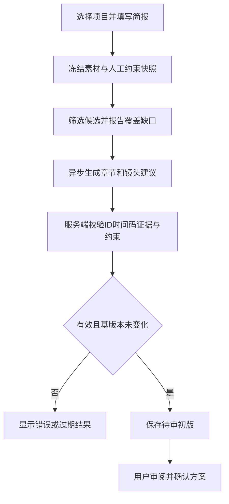
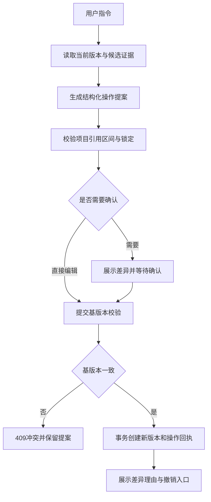

# TSB-365 目标架构与实施任务

日期2026-11-05；当前基线 main@0c57aee13ec298af92e3ea8fe11c88bcfee19ddc。**本文全部新增设计均为建议，尚未实现**。现状证据见 [能力矩阵](TSB-365_CURRENT_CAPABILITY_MATRIX.md)，问题编号见 [整体审计](TSB-365_AI_DIRECTOR_PRODUCT_AUDIT.md)。不开发最终成片渲染；原生视频模型不是前置条件。

## 1. 最小领域模型与现有架构映射

| 目标能力 | 现有模型 / API / UI | 建议与差距 |
|---|---|---|
| 导演偏好 | Project.settings；ProjectCreate/Update；Home创建时传空settings | settings.director 使用独立Pydantic模型；无需先建DirectorProfile表；每版本冻结brief |
| 自动策划 | Job可复用；story/analyze仅同步建议；AIDirector有分析按钮 | 新增director_plan异步任务类型，读取候选快照，生成待审方案；不改现有视觉Provider |
| 故事板/章节 | 项目级EditPlanShot平面列表；edit-plan；Export | 新增Storyboard头与不可变StoryboardVersion；章节先嵌JSON，避免立即拆七张表 |
| 镜头条目 | EditPlanShot具有双ID/区间/用途 | 版本JSON内稳定shot_id、章节、理由/证据/锁定；现有导出改为读取指定版本适配器 |
| 对话修改 | 无会话领域/API/UI | 新增DirectorMessage与PlanOperation；消息不可直接改变方案，操作必须过校验 |
| 方案版本 | 无；保存全量替换 | 唯一(board_id,version_no)、parent_version_id、base_version校验与头指针CAS |
| 指导书 | JSON/CSV/OTIO；Export下载 | 统一版本读取和验证服务，Markdown/CSV先交付，打印/PDF后置；本地路径与共享脱敏两种模式 |

首期新增5类表：Storyboard、StoryboardVersion、DirectorMessage、PlanOperation、StoryboardSourceRef（后者仅存版本到Asset/Segment引用索引，避免JSON内引用无法查询）。章节和镜头先采用有schema_version的完整JSON快照，减少关系表与快照双写复杂度。若测量显示需要逐条SQL查询再规范化，不能同时维护两套权威镜头数据。

- Storyboard：id/project_id/title/current_version_id/created_at；首期可限制每项目一个主方案，保留以后多方案空间。
- StoryboardVersion：id/board_id/version_no/parent_version_id/schema_version/brief/sections/shots/constraints/validation_summary/created_at/actor/reason/job_id。内容不可覆盖；review状态变更也创建版本。
- StoryboardSourceRef：version_id/shot_id/asset_id/segment_id/source_signature，供失效查询；写快照同事务派生，不可独立编辑。历史引用不通过级联删除消失；项目删除的清理生命周期另受既有策略约束。
- DirectorMessage：id/project_id/board_id/session_id/role/text/base_version_id/request_id/status。只保存用户交互和展示摘要，不保存模型内部思维链。首期一个主会话即可，无需独立Conversation表。
- PlanOperation：id/board_id/base_version_id/message_id/idempotency_key/operations/diff/status/result_version_id/reason。状态 proposed/applied/rejected/stale/failed；确认操作不可重复应用。

复用 Project/Asset/Segment/Frame/Job、UserAnnotation和视觉结果家族，不复制原片、人工评分或语义结果。证据引用记录 result_id、method、帧时间或区间、输入签名、人工判定版本。源不存在时历史快照仍可阅读，当前有效性由校验器附加，绝不改写历史或自动换ID。

旧 EditPlanShot 的迁移：先备份；把现有顺序与全部提示字段一次性导入v1，记录legacy来源与未核实状态；不编造理由或证据。迁移幂等，空计划无虚构镜头。兼容旧 GET/导出读取新快照；旧 POST 在迁移后必须要求base_version或明确拒绝旧客户端写入，避免旁路覆盖。粗剪经适配器读取同一指定版本，保留既有功能，不让其成为前置步骤。

## 2. 输入、候选与自动策划

首屏必填：选择项目、目标时长、主题（一句话）。可选：平台/画幅、风格、叙事重点、人物/风景/城市/活动偏好、可用素材范围、必含/禁用镜头；采用可解释默认值，不要求填满复杂表单。用户评分、收藏、排除、备注、裁剪默认纳入上下文，显示摘要供纠正。

输入先转为类型化brief：目标时长正数，偏好比例范围与总和规则明确；范围ID必须属于项目。收藏是软偏好，不等于全部必须出现；exclude、明确禁用、人工锁定为硬约束。锁定与禁用冲突时阻止提交并请用户解决，不偷偷按模型偏好取舍。

候选构建先做硬过滤：当前项目、源身份有效、非needs_review、未排除、有效可编辑区间。随后按人工偏好、主题证据、技术指标、相似簇与素材覆盖排序，保留不同来源。报告总素材数、可用数、入选上下文数、未覆盖原因。不能只把前N张图送模型后声称理解全库。

模型只读取候选manifest（别名、双ID、秒数、已授权语义与人工信号），输出严格结构化章节及镜头建议。片段不足时返回missing_materials/unmet_constraints，允许用户接受更短方案，不能虚构镜头。目标时长为策划目标，不调用编码器补足。

建议采用异步Job：候选构建/模型等待/校验/待审发布四阶段，超时与取消可见；配置快照、请求幂等键、输入版本和预算可审计。网络调用期间不持SQLite写事务。提交前重新校验输入签名与base_version；用现有项目互斥遵守“项目锁→写事务”的锁序，若项目已变化则结果标stale，不覆盖用户编辑。模型输出结构错误仅有限重试，不擅自切换上传策略。

图为目标流程；仅素材/人工数据与Job底座已存在。无需生成代理或粗剪即可完成全部步骤。

## 3. 共享操作协议与对话导演

自动初版与对话都调用同一方案校验/版本发布服务。模型不直接执行SQL、文件操作或任意API。用户素材备注和导入文本当作数据，不能改变工具权限；模型不得访问其他项目。

| 用户意图 | 结构化操作 | 规则 |
|---|---|---|
| 把极光放到最后 | move_shot / move_section | 先按证据找候选；多个匹配展示选择，不凭名称猜地点 |
| 多些人物镜头 | insert_shot + update_constraints | 从当前项目有效人物标签候选选，说明时长变化 |
| 不连续相似风景 | update_constraints + reorder | 相似簇与主题分开，锁定位置不可被破坏 |
| 开场更有冲击力 | replace_shot | 提供候选和理由，创作判断标为建议 |
| 节奏快一点 | trim_shot + update_pacing | 只在有效源区间缩短；不隐式变速 |
| 删除这个镜头 | remove_shot | 只移出方案，不删除Segment/Asset/文件 |
| 换类似镜头 | replace_shot | 明确替换前后ID与证据，不能重映射旧ID |
| 保留这个镜头 | lock_shot | 可分锁定引用/区间/位置，后续操作逐项遵守 |
| 回到上一版本 | restore_version | 拷贝目标快照形成新版本；校验当前引用有效性 |

纯建议（解释理由、列候选）不改版本。用户明确点选的单镜头移除/移动/锁定可直接提交可撤销操作；自然语言的批量替换、整体节奏、章节重组先展示diff并确认；不明确指代必须澄清。原片删除/移动/改名/覆盖、修改模型授权与外发策略从工具集合中排除。确认不能沿用到不同base_version。

操作信封至少包含schema_version、board_id、base_version_id、idempotency_key、operations、user_intent、evidence_refs。操作使用稳定shot_id而非数组下标；insert/replace包含asset_id、segment_id、精确秒数、理由、章节；未知字段/操作拒绝，服务端限制大小和数量。

撤销/恢复均新建版本，不删除历史。每个版本保留原指令、变化摘要与父版本；消息与操作分离使“模型回答了”不等于“计划已修改”。失败重试复用幂等键，不能重复插入镜头。多标签页带base_version；同一基线最多一个写入成功，其余409，不自动重新生成覆盖。

## 4. 校验与导出契约

校验至少覆盖：项目存在、Asset与Segment均属项目且匹配、源签名、当前区间/检测状态、有限数值、in<out、源时长上限、时长下限、锁定与排除、唯一shot_id、有效章节、证据来源与过期、整体时长偏差。模型只能提出草案，不能把review_status写成confirmed。

源移动/缺失/损坏、人工裁剪和重新检测后，读取历史仍返回原快照，额外给出missing_source/source_changed/segment_needs_review/out_of_range等验证结果。正式指导书禁止将失效镜头标为可执行；可导出有醒目未解决标记的审阅草稿。导出校验发生在所选版本，期间记录来源签名快照，变更则拒绝或标stale；不自动换素材。

时间基准：源入出点统一秒数并约定半开区间[in,out)；VFR秒数权威，帧号仅辅助。无变速时，实际使用源出点明确为in+recommended_duration；候选可用区间另列，不能让用户误把较长source_out当实际剪辑出点。OTIO按有理帧率换算并标记舍入误差；验收采用独立解析器和真实NLE，不能只看JSON格式合法。

指导书包含封面（版本/日期/主题/目标与实际时长/适用画幅/限制）、章节概述、逐镜头执行表、音乐节奏与旁白建议、待确认清单、源素材索引。每个条目包括：序号、章节目的、shot_id、asset_id、segment_id、素材名、本地定位路径或共享别名、来源签名、实际源入出点、可用区间、推荐时长、画面描述、选择理由、叙事角色、前后衔接理由、音乐/节奏、转场、字幕旁白、证据支持的景别/运动、人工确认及不确定性。

输出：Markdown详细指导书为首期必需，CSV镜头清单为首期必需；JSON/OTIO兼容保留；打印样式/PDF为后续增强，Excel不必首期增加。所有输出带board_id/version_id/schema_version并从同一快照导出。CSV必须正确转义、处理公式注入、保留中文和小数精度。同名素材用ID区分。

本地执行版允许显示定位路径；共享/上传版默认移除真实路径与EXIF/GPS，使用别名和ID。两种模式明确标识，不能把含路径OTIO当脱敏上传包。导演不为导出自动调用模型或外发任何资料。

## 5. 建议API与UI

新增路由均位于现有/api鉴权和回环保护下，不能绕开安全中间件。

| 方法与路由（建议） | 输入与结果 |
|---|---|
| PUT /projects/{p}/director-profile | 类型化brief；返回校验结果与偏好版本 |
| GET /projects/{p}/director-candidates | 分页、语义条件、有效性、人工偏好；返回证据与未覆盖统计 |
| POST /projects/{p}/jobs/director_plan | brief、base_version、idempotency_key；202 JobOut |
| GET /projects/{p}/storyboards/{b} | 当前头、版本摘要、验证状态 |
| GET /projects/{p}/storyboards/{b}/versions/{v} | 不可变快照+当前有效性，读操作不修改人工状态 |
| POST /projects/{p}/storyboards/{b}/messages | text/base_version/request_id；返回异步Job或提案标识，不直接写方案 |
| POST /projects/{p}/storyboards/{b}/operations | typed operations/base_version/idempotency_key；创建提案或执行明确手工编辑 |
| POST /projects/{p}/storyboards/{b}/operations/{o}/apply | 确认令牌与base_version；新版本或409 |
| POST /projects/{p}/storyboards/{b}/restore | target_version/base_version；创建新版本 |
| GET /projects/{p}/storyboards/{b}/versions/{v}/export | format/privacy_mode；确定版本输出或稳定校验错误 |

错误码建议：PROJECT_MISMATCH、SOURCE_CHANGED、INVALID_RANGE、LOCK_CONFLICT、PLAN_VERSION_CONFLICT、STALE_PROPOSAL、INSUFFICIENT_MATERIAL、MODEL_OUTPUT_INVALID；详情包含镜头定位信息但不泄露另一项目内容。跨项目对象可以统一404。

UI延续现有路由：项目页进入导演工作区；左侧候选与约束、中间章节/镜头列表、右侧对话与变更提案；顶部版本/目标时长/未解决警告，下方可选预览。初版生成、差异确认、版本恢复、导出均可单独完成。Review继续负责素材人工判定；Export逐步作为版本导出视图，避免两个编辑器各自保存一套数据。移除旧入口前须保持兼容，不在本轮更改。

## 6. 分阶段任务拆分与验收

编号为建议占位，尚未在外部系统创建。后续每项按AGENTS先红后绿，生产接线单测+反向验证，发布记录、回归映射与全量检查；不能把本文验收要求写成已通过。

| 顺序/任务 | 优先级、依赖 | 具体交付 / 涉及模块 | 可观察验收标准 |
|---|---|---|---|
| TSB-366 方案版本与兼容迁移 | P0；先行 | models/database/schemas；Storyboard与版本/引用索引；旧计划导入与只读适配 | 迁移重复运行不重复；所有旧字段保留；两个同base写入仅一个成功；重启后历史可读；原片字节不变 |
| TSB-367 操作协议与引用校验 | P0；366 | PlanOperation、版本CAS、锁定/撤销、统一校验器；edit-plan写入兼容门禁 | 跨项目/NaN/越界/伪ID拒绝且旧版本字节不变；重复键不重复应用；恢复不删除历史；失效镜头不能自动确认 |
| TSB-368 候选查询和策划简报 | P1；366，可与367独立开发但发布依赖367 | settings类型化、人工约束快照、语义与相似候选索引 | 排除镜头绝不入选，收藏仅软偏好；缺少人物候选明确报告；记录覆盖率分母；过期语义不冒充当前事实 |
| TSB-369 异步自动策划 | P0；367+368 | director_plan Job、结构化输出、章节/理由、待审初版UI | mock先验证全链路，生产调用点参数检查；故障/取消不发布半方案；并发编辑使结果stale；无模型时明确不可生成、不伪装成功 |
| TSB-370 版本指导书 | P1；367，基于手工版本即可 | Markdown/CSV+JSON/OTIO适配，明确版本与隐私模式 | 同版本所有镜头/区间一致；同名源可定位；失效阻断正式版；共享版无真实路径；无模型调用也可导出；草稿不会被误标已保存 |
| TSB-371 对话操作与差异工作区 | P0；369及367 | messages、意图提案、九类操作、确认/冲突/恢复UI | 九类意图均有用例；歧义先澄清；批量需确认；过期确认409；拒绝原片操作；reload后消息/提案/版本一致 |
| TSB-372 业务验收与证据收口 | P1发布门禁；369–371 | 先离线合成，再获授权真实素材/模型；人工导演评分、目标NLE执行 | 8–10段覆盖竖屏/无音轨/HDR等；按指导书逐镜头定位；人工评估叙事/依据/可执行性；原片哈希不变；记录未满足项，不以mock替代 |
| TSB-373 大规模检索与UI效率 | P2；368后，性能门禁独立 | 分页候选、虚拟列表、索引测量；必要时才规范化快照 | 固定数据集量测响应/内存/覆盖；60+视频/200GB单独实际运行，不外推；无静默漏项 |

最小可交付里程碑：366+367+370先提供可靠的手工版本化指导书；368+369提供自动初版；371形成交互导演完整闭环；372完成业务验收。P2不应挤占版本安全和导演操作核心。

每项拆出独立测试资产与完成证据；真实模型验收需另行明确授权，不把本次审计授权延伸为未来外发许可。暂不排开发工时：方案版本兼容与人工验收成本尚未量测，以上以可验收依赖排序代替虚假精确估时。
